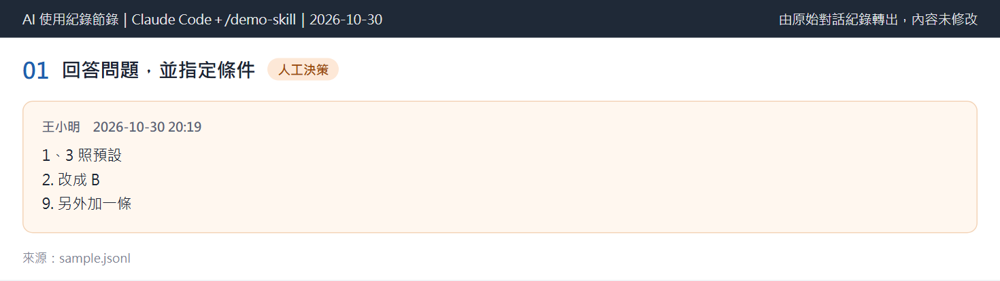

# ai-usage-log

把 [Claude Code](https://claude.com/claude-code) 的對話紀錄（`.jsonl`）自動整理成課程「AI 應用文件」需要的素材：

- **紀錄表（`.xlsx`）**：每個任務一列、有下拉選單，可統計
- **關鍵畫面（`.png`）**：把對話片段排版成卡片，內容與原始紀錄逐字一致
- **完整文字紀錄（`.md`）**：去掉工具細節，只留人與 AI 的對話

重點是「人的判斷」：紀錄表的「人工判斷與修正」欄只能寫對話中真的發生過的事，找不到依據時會標 `[待確認]`，
而且草稿一定要由你確認後才會寫入檔案。



（上圖由虛構的範例紀錄產生。）

## 安裝

需要 Python 3.10 以上。**不需要自己安裝套件**：第一次執行 `/ai-usage-log` 時，skill 會在
`~/.claude/ai-usage-log-venv`（Windows 為 `%USERPROFILE%\.claude\ai-usage-log-venv`）自動建立專用環境，
裝好 openpyxl、markdown-it-py、playwright、tzdata 與 Chromium（約一兩分鐘），不會動到系統的 Python。
可用環境變數 `AI_USAGE_LOG_VENV` 改位置；也可手動執行 `python ai-usage-log/scripts/setup_env.py` 預先準備。

把 `ai-usage-log/` 資料夾複製到使用者層級的 skills 目錄（所有專案都能用，也不會進到任何專案的 repo）：

- Windows：`%USERPROFILE%\.claude\skills\ai-usage-log\`
- macOS／Linux：`~/.claude/skills/ai-usage-log/`

也可以放在單一專案的 `.claude/skills/` 底下。開發時在 Windows 可執行 `scripts/install.ps1`，
它會建立目錄連接，改程式後不必重新複製。

Chromium 安裝失敗時也能跑，只是圖片會退回輸出 HTML。

### 快速上手（Windows）

1. 確認電腦有 Python 3.10 以上：在終端機輸入 `python --version`（或 `py --version`）能看到版本即可。
2. 到本頁按綠色的 **Code → Download ZIP** 並解壓縮（或用 GitHub Desktop clone）。
3. 把解壓縮後**裡面的 `ai-usage-log` 資料夾**（不是整個 repo）複製到 `C:\Users\<你的使用者名稱>\.claude\skills\`，
   完成後要能找到 `...\.claude\skills\ai-usage-log\SKILL.md`。
   `.claude` 是隱藏資料夾，可在檔案總管網址列貼上 `%USERPROFILE%\.claude` 進入；沒有 `skills` 資料夾就自己建立。
4. 在要記錄的專案開一個**新的** Claude Code 對話（舊對話不會載入新 skill），輸入 `/ai-usage-log`。
5. 第一次會自動建立專用環境（一兩分鐘，請稍候），接著詢問你的**姓名**；之後會產生 `G-AI使用紀錄-<姓名>.xlsx`，每個人各自一份。

輸入 `/ai-usage-log` 沒反應時，通常是資料夾多放了一層（變成 `skills\ai-usage-log\ai-usage-log\`），或是沒有開新對話。

## 使用

在你要記錄的專案裡開 Claude Code，輸入：

```
/ai-usage-log
```

或直接指定紀錄檔：

```
/ai-usage-log D:\path\to\session.jsonl
```

流程：讀設定檔（第一次會詢問並建立 `ai-usage-log.config.json`）→ 列出可處理的對話 → 解析 →
**草擬紀錄表與圖片清單，在對話中請你確認** → 產生 xlsx、png、md → 回報待補項目。

### 資料從哪來

skill 讀的是 Claude Code 自動存在本機的對話紀錄（`~/.claude/projects/` 底下），**不需要你把對話複製貼上**。
在 VS Code 擴充套件、終端機裡使用 Claude Code 都一樣會產生這些紀錄；關掉分頁也不會刪除。

注意：Claude Code 預設只保留本機對話紀錄 30 天（設定 `cleanupPeriodDays` 可調整，
見[官方設定文件](https://code.claude.com/docs/en/settings-reference)），過期的紀錄會被清除，請在期限內整理。

### 圖片不會被覆蓋

產生圖片時若目標資料夾已有同名檔案，程式會停下來並列出清單（結束碼 3），不會動任何檔案；
確定要取代時才加 `--overwrite`，或改用不同的檔名前綴。

### 輸出位置

skill 會以目前工作目錄所在的 **git 專案根目錄**為基準（用 `git rev-parse --show-toplevel` 找）；
不在 git 專案裡就用目前的工作目錄。所以不論從專案的哪一層資料夾開啟 Claude Code，
設定檔都會放在同一個位置。每次執行時 skill 會先找專案裡有沒有名為 `ai-log` 的資料夾：

- 只有一個 → 直接使用，不再詢問。
- 有多個 → 請你選一個。
- 一個都沒有 → 問你要在哪裡建立（預設是專案根目錄下的 `ai-log`）。

選定的位置會寫進設定檔的 `output_dir`。團隊共用同一個 repo 時，請大家使用相同的資料夾。
決定好之後，個人檔案（設定檔、進度檔、草稿）會自動加進 `.gitignore`。

### 設定檔

放在上述的專案根目錄，所有選項都從這裡讀：

```json
{
  "member_name": "王小明",
  "timezone": "Asia/Taipei",
  "card_theme": "dark",
  "output_dir": "ai-log",
  "image_dir": "ai-log/images",
  "workbook": "ai-log/G-AI使用紀錄-王小明.xlsx",
  "activities": ["需求", "設計", "程式", "測試", "除錯", "審查", "文件", "管理"],
  "adoption_levels": ["直接採用", "小幅修改", "大幅修改", "僅參考", "不採用"]
}
```

只需要姓名。每個人在自己的電腦產生自己的 Excel（檔名帶姓名），所以紀錄表沒有「成員」欄，
也不需要成員編號或全組名單；舊版設定檔裡的 `member`、`members` 會被忽略。
若手上有舊版（有「成員」欄）的 Excel，程式會拒絕寫入以免欄位錯位，請改名備份或換一個檔名。

多人共用同一個專案 repo 時，`ai-usage-log.config.json` 與 `ai-log/.ai-usage-log-state.json` 是個人的，
不應該提交，否則別人 pull 後會沿用你的姓名與檔案。skill 每次執行都會自動把它們（以及 `ai-log/.draft/`）
追加到專案的 `.gitignore`（只在結尾加一個區塊、不重複、不動你原有的內容）。

`card_theme` 決定圖片配色：`dark`（預設，深色）或 `light`（淺色，版面完全相同，只換顏色）。

### 隱私

- 圖片與文字紀錄輸出前會遮罩金鑰、token、email、使用者家目錄與密碼欄位，並在圖片頁尾註明。
- 個人設定、進度檔與草稿資料夾會自動加進專案的 `.gitignore`；建議只提交 `.xlsx`、`.png`、`.md`。
- 所有處理都在本機進行，不會上傳任何資料。

## 開發與測試

```bash
python -m venv .venv
.venv/Scripts/python -m pip install -r ai-usage-log/requirements.txt pytest   # Windows
.venv/Scripts/python -m pytest
```

測試資料全部是自己編寫的虛構紀錄（`tests/fixtures/`）。規格見 [SPEC.md](SPEC.md)。

## 致謝

紀錄表的欄位設計參考了同課程另一組的做法，感謝 [@Lavender0720](https://github.com/Lavender0720)。

## 授權

[MIT](LICENSE)
